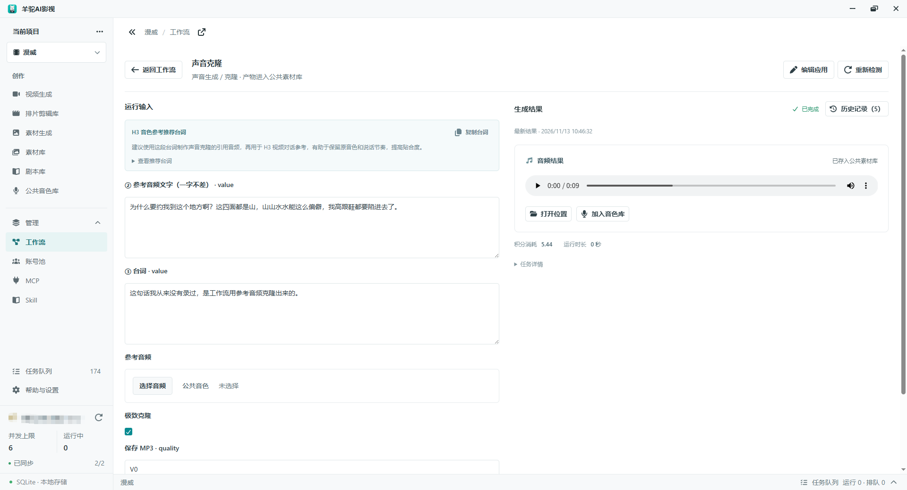
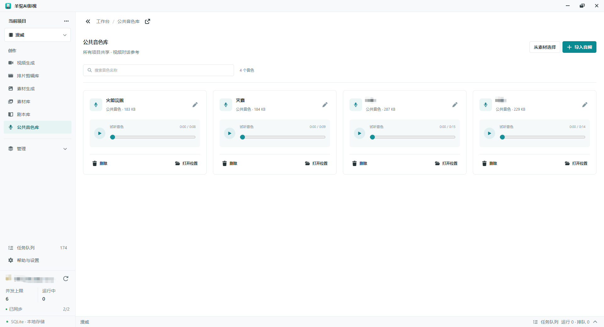
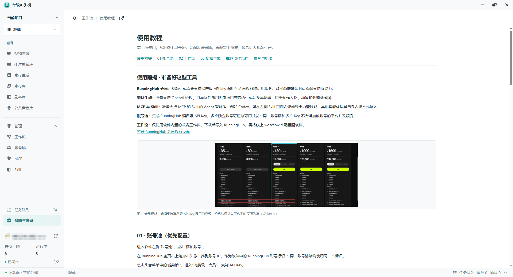

# 羊驼AI影视

面向个人创作者的本地 AI 视频制作工作台，将剧本、参考素材、视频生成、素材归档和排片剪辑放在同一个桌面应用中。

[下载发行版](https://github.com/codecnmc/rh-video-manager/releases) · [操作指南](GUIDE.md) · [反馈问题](https://github.com/codecnmc/rh-video-manager/issues) · [MIT 许可证](LICENSE)

软件免费，RunningHub 和生图服务的生成费用由对应平台收取。项目仍在开发中，生成效果、价格和预览能力以实际服务为准。

## 平台支持

目前仅支持 **Windows x64**，下载 ZIP 后完整解压，运行 `羊驼AI影视.exe`。

**暂不支持 macOS 和 Linux。** 当前媒体引擎、安装准备脚本和打包流程均针对 Windows，不能直接在 Mac 上运行现有发行包或按当前脚本完成安装。Electron 的跨平台能力不等于本项目已经完成跨平台适配。

## 界面预览

### 视频生成与排片剪辑


### 素材生成与管理


<details>
<summary>更多界面</summary>










</details>

## 主要功能

- **项目与视频草稿**：分组、复制、多窗口编辑，生成视频不要求先有剧本。
- **独立剧本库**：Markdown 编辑、预览与分屏。
- **素材库**：按项目或公共范围管理图片、视频、音频和提示词，支持文件夹、标签、多选引用与归档。
- **RunningHub 视频生成**：账号与工作流配置、全能参考提示词、任务进度、采样与低清预览、成片下载。预览是否可用取决于线上工作流和平台支持。
- **消费明细**：查看成功视频任务的耗币，按账号、项目和日期筛选，补查历史任务费用；平台未返回的费用保留为未知。
- **声音工作流与公共音色库**：下载音色设计、声音克隆模板，运行并收纳音频结果，用于视频音色参考。图片工作流模式已停用。
- **素材生成**：连接生图服务，管理图片任务、参考图、结果版本和归档。
- **排片剪辑**：素材编排、时间轴、声音、字幕、版本管理与 MP4 导出。
- **MCP 与 Skill**：授权兼容客户端访问工作台，提供导演、H3 提示词、剪辑、MCP 和剪映草稿技能。
- **首次使用引导**：逐步定位页面和操作入口，可在设置中重新打开。

## 快速开始

### 生成视频

1. 在「账号池」添加 RunningHub API Key，保存后同步账号信息和额度。
2. 在「工作流总览」下载 H3 全能参考工作流，在 RunningHub 网页导入并保存到自己的账号。
3. 将该工作流 ID 添加到软件，绑定对应账号并检测。
4. 新建项目和视频草稿，填写提示词、添加参考素材。
5. 选择账号与工作流，核对参数和收费后确认提交，在生成界面或任务队列查看结果。

### 生成图片

图片生成需要在「素材生成」中另行配置生图服务的协议、API 地址、Key 和模型，不能直接复用 RunningHub 视频账号。创建任务组后添加图片任务，填写提示词和参考图，确认收费后提交。

更多操作见 [使用指南](GUIDE.md)。

## 数据与使用须知

- 项目数据与素材保存在本机；API Key 通过系统加密保存。
- 导入素材不会立即上传，确认生成时才提交所需参考文件。
- 关闭软件不等于取消远端任务。受理结果不明时先核对平台记录，避免重复提交和扣费。
- 在「设置」检查软件更新、备份和迁移数据。更新前保存并备份，退出旧版后将新版完整解压到新目录，不要只替换 EXE。
- MCP 是可选功能，需单独授权范围和权限；不要将访问令牌暴露到公网或公开 Issue。

## 源码开发

开发环境：Windows x64、Git、Node.js >= 22.12.0、pnpm 8.15.4。安装依赖时会准备 Electron 和本地媒体引擎。

```powershell
pnpm install --frozen-lockfile
pnpm dev
```

| 命令 | 用途 |
| --- | --- |
| `pnpm build` | 构建应用 |
| `pnpm typecheck:node` | 主进程与 preload 类型检查 |
| `pnpm typecheck:web` | 界面类型检查 |
| `pnpm package:win:release` | 打包 Windows x64 ZIP 与 SHA-256 |

技术栈：Electron、React、TypeScript、shadcn/ui、Tailwind CSS、Font Awesome、SQLite。

### 发布版本

将 `package.json` 版本和 `vX.Y.Z` 标签保持一致，再将提交与标签推送到 GitHub。[Windows Release](.github/workflows/release.yml) 会构建、校验并上传发行包，附件上传成功后自动公开 Release。失败时不会公开不完整的发行包，已发布版本不会被覆盖。

也可在 GitHub Actions 中手动运行并指定已有版本标签。软件更新检查只读取正式 Release，不自动下载安装。

## 反馈与贡献

反馈问题请提供软件版本、Windows 版本、复现步骤和错误信息，不要上传 API Key、访问令牌、数据库或私人素材。

参与开发前请阅读 [工程规范](AGENTS.md)，并在 PR 中说明变更范围与验证结果。

## 许可证

项目自有代码采用 [MIT](LICENSE) 许可证。第三方依赖、字体、技能资料和媒体引擎遵循各自许可证，详见 [资源说明](resources/NOTICE.md)、[字体说明](resources/fonts/NOTICE.md) 和 [媒体引擎说明](resources/notices/media-engine.md)。分发包含 FFmpeg 的发行包时，需履行对应许可证的源码提供等义务。
