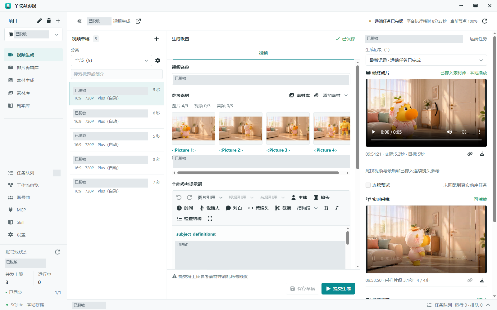
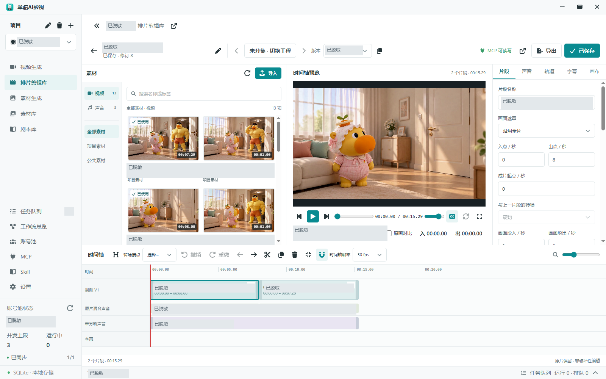
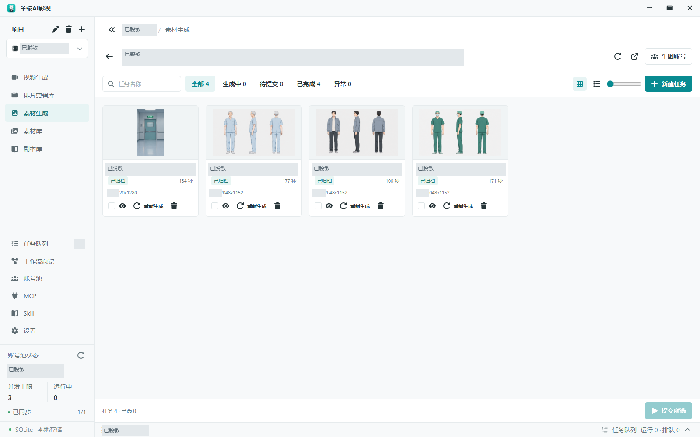
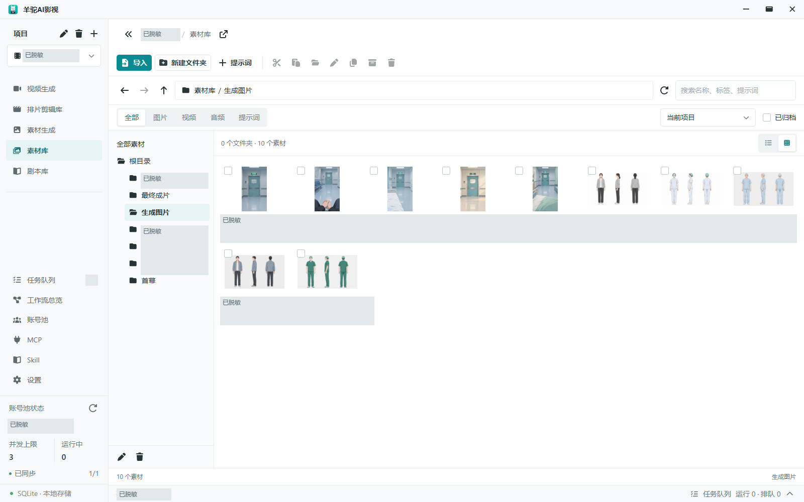
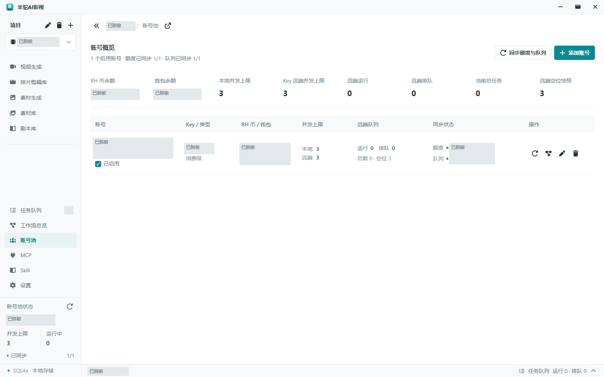
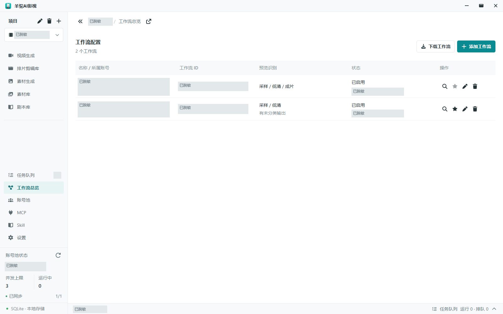
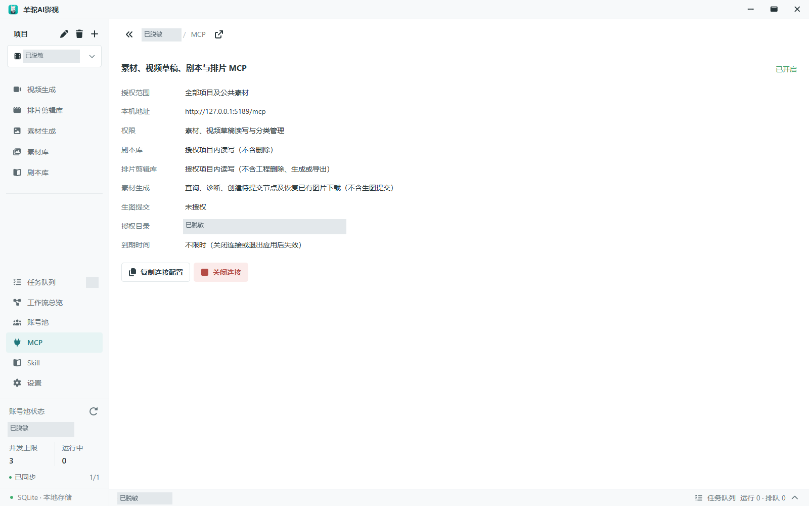
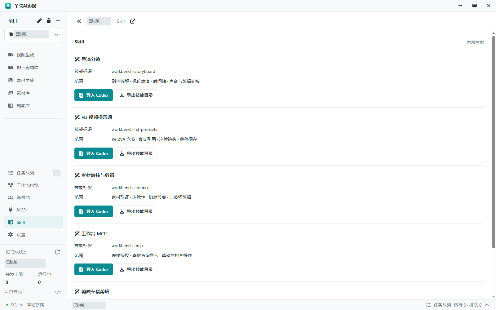
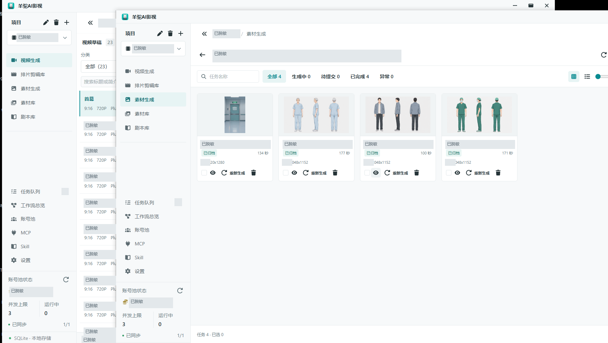

# 羊驼AI影视

面向个人创作者的 Windows 本地 AI 视频制作工作台，将剧本、参考素材、生成草稿、视频任务和排片剪辑放在同一个桌面应用中。项目数据与受管素材保存在本机，联网生成由配置的服务提供。

项目仍在开发中。代码实现不代表已完成运行验收、真实付费联调或发布审计；生成效果、价格、额度与预览能力以实际服务为准。

[GitHub 仓库](https://github.com/codecnmc/rh-video-manager) · [下载发行版](https://github.com/codecnmc/rh-video-manager/releases) · [操作指南](GUIDE.md) · [MIT 许可证](LICENSE)

仓库目前为私有，仅获授权的 GitHub 用户可访问；公开后以上链接即可供所有人使用。软件本身免费开源，RunningHub 和生图站的生成费用由对应服务收取。

## 界面预览

以下为软件实际界面，账号、余额、项目名称、工作流 ID、私人文本和目录已做不透明遮挡。

### 视频生成与粗剪





### 素材生成与管理





<details>
<summary>更多界面：账号、工作流、MCP、Skill 和多窗口</summary>











</details>

图片存放与脱敏要求见 [截图说明](media/screenshots/README.md)。

## 功能

- **项目与草稿**：项目、视频分组、独立草稿、复制与多窗口编辑；视频生成不要求先有剧本。
- **剧本库**：不绑定项目的独立 Markdown 编辑、预览与分屏。
- **素材库**：图片、视频、音频和提示词，按项目/公共范围、目录与标签管理。视频参考选择支持多选和右侧已选列表，替换引用保持单选。粘贴图片按 MD5 在相同范围内复用有效素材，不自动移动或重命名已有素材。
- **RunningHub 视频生成**：账号内工作流、全能参考编辑、付费提交确认、任务快照、状态监听、采样/低清预览及成片下载。预览取决于线上工作流和平台实际转发能力。
- **素材生成**：图片生成账号、任务组、版本和结果归档；实际协议、模型与并发依赖所配服务，收费与视频生成分别授权。
- **排片剪辑**：素材编排、版本化工程、声音处理、媒体检查与成片导出，依赖可用的本地媒体引擎。
- **MCP 与 Skill**：受控访问工作台数据，提供独立的导演、H3 提示词、剪辑、MCP 和剪映技能，不强制绑定 Codex。
- **扩展与迁移**：插件扩展入口与加密迁移包，具体权限、依赖和兼容性以功能契约为准。

## 开始使用

### Windows 发行包

如使用维护者提供的发行包，请完整解压后运行 `羊驼AI影视.exe`，不要只复制 EXE。首次使用从空工作台开始，不自动创建示例或提交生成。

### 第一次生成视频

1. 打开「账号池」，导入自己的 RunningHub `API Key`，保存账号。
2. 执行「同步数据」，确认账号信息和额度已同步。
3. 打开「工作流总览」，点击「下载工作流」，保存软件内置的 H3 全能参考工作流 JSON。
4. 在 RunningHub 网站的「工作台」导入该 JSON，保存为自己账号下的工作流。
5. 复制 RunningHub 上的 `workflow-id`，回到软件「工作流总览 → 添加工作流」，选择对应账号，填写名称和工作流 ID，启用并检测工作流；需要时设为该账号默认。
6. 建立项目和视频草稿，填写提示词、添加参考素材，选择刚配置的账号与工作流。核对参数和费用并确认提交，即可运行视频生成。

工作流按账号绑定，不能用别人的 ID 代替自己的工作流。内置模板已随源码和应用提供，不需要额外下载开发者的私有文件；[模板源文件](src/main/providers/runninghub/h3-comfyui-template.json) 保留在版本控制中。

### 第一次生成图片素材

素材生成需要单独添加对应的**生图站**，不是导入 RunningHub Key 后就能直接使用。在「素材生成」的账号配置中，选择服务支持的协议，填写生图站的 API 地址、API Key 和模型等信息；再创建任务组，添加图片任务、提示词及所需参考图，核对账号和收费后提交。成功结果归档后可在素材库中继续用于视频参考或剪辑。具体步骤见 [操作指南](GUIDE.md#素材生成)。

不要安装不可信的插件、技能或媒体引擎。

关闭软件不等于取消远端任务，也不保证退款。受理不明时应先核对原任务，避免重复提交或换账号重试造成重复扣费。

### 源码开发

当前面向 Windows x64，其他平台未声明支持。需要 Git、Node.js >= 22.12.0、pnpm 8.15.4；依赖以 `pnpm-lock.yaml` 为准。数据库相关脚本还需要当前 Node 支持 `node:sqlite`；桌面应用使用 Electron 自带的 Node 运行时。

```powershell
pnpm install --frozen-lockfile
pnpm dev
```

安装可能联网下载 Electron 和媒体引擎依赖。`postinstall`、开发和构建命令会执行 `scripts/media-engine/prepare.mjs` 准备媒体引擎，请先阅读脚本并确认依赖来源。

开发服务器仅监听 `127.0.0.1:5188`，端口占用直接报错。不要同时运行使用同一数据目录的开发版和打包版。

| 命令 | 用途 |
| --- | --- |
| `pnpm dev` | 启动开发环境与 Electron |
| `pnpm build` | 编译主进程、preload 与界面 |
| `pnpm preview` | 运行已构建应用 |
| `pnpm typecheck:node` | 主进程和 preload 类型检查 |
| `pnpm typecheck:web` | 界面类型检查 |
| `pnpm package:win` | 生成 Windows 解包目录 |
| `pnpm package:win:empty` | 生成使用独立空白数据目录的 ZIP |
| `pnpm package:win:data` | 生成使用本机原数据目录的调试 ZIP，不复制数据或 Key |

回归用例位于 `tests/`，部分需要 SQLite、Electron 或专用脚本；插件测试入口见 `package.json`。单个模块通过不等于完整应用验收。

### 软件更新

「设置 → 软件更新 → 检查更新」查询本仓库最新的正式 GitHub Release，并与当前版本比较。点击「发布页面」在浏览器下载完整发行包；不会自动下载、安装、覆盖数据或重启软件。

仓库私有、尚无正式 Release 或 GitHub 限流时会提示检查失败，不会误报为已是最新版。私有阶段可在浏览器登录有权限的 GitHub 账号后下载；应用不保存 GitHub Token。发布者应使用 `v主版本.次版本.修订号`（如 `v0.1.1`），同步 `package.json` 版本并上传完整 Windows ZIP；Draft 和 Pre-release 不参与正式版检查。更新前保存编辑内容并备份数据，关闭旧版本后将新版完整解压到新目录，不要只替换 EXE；保持使用同一数据 profile，不同时启动新旧版本。

## 数据与安全

默认沿用 `%APPDATA%\AI 视频工作台`，品牌改名不自动搬迁旧数据。独立空白发行包使用单独 profile；素材存储位置可在应用中配置，不应假设始终位于默认目录。

- 项目、剧本、草稿、任务、素材元数据与账号配置使用 SQLite，不用 localStorage 保存业务数据。
- API Key 在主进程通过系统 `safeStorage` 加密；系统加密不可用时拒绝保存，不降级明文。直接跨电脑复制数据库不保证能解密，应使用专用迁移流程。
- 导入素材只落本地；确认相应生成操作后才上传引用文件。联网生成不是完全离线能力。
- 删除通常是软删除，不自动清理受管文件；不要直接改数据库实现删除或恢复。
- 加密迁移包包含账号凭据与素材，不应公开发布；遗失密码无法恢复。

## MCP

在应用 MCP 页面选择范围、时长和权限，再复制配置到所用客户端。服务固定监听 `http://127.0.0.1:5189/mcp`，校验 Bearer、Host 与 Origin。复制配置含本机会话令牌，**不要放进公开 Issue、截图或仓库，也不要暴露服务到公网**。

首次默认只读，写入另授导入目录；剧本、剪辑、素材生成与提交等权限分别控制。授权时长为 5–120 分钟或不限时；手动关闭、退出或到期使当前会话失效。已配置有效范围和目录时可按设置随启动恢复；可关闭自动开启，手动关闭后本进程不自动重开。

素材写权限不等于付费生成权限。服务不提供素材/项目/草稿删除、账号密钥读取或任意磁盘访问；具体工具以运行实例实际开放的 schema 为准。

## 内置技能

在侧栏 Skill 页面分别安装或导出：

| 标识 | 职责 |
| --- | --- |
| `workbench-storyboard` | 导演分镜、机位表演、时间轴与声音交接 |
| `workbench-h3-prompts` | H3 Ref2VA 六节提示词、连续性与真实引用 |
| `workbench-editing` | 素材复核、选片、切点与非破坏剪辑 |
| `workbench-mcp` | 连接授权、素材与工作台数据操作 |
| `jianying-draft-editor` | 剪映可编辑草稿，Python 与 pyJianYingDraft 另配 |

各包自带参考资料，不要求安装旧整合技能，不包含参考图生图模块。“导入 Codex”只是便利安装入口，也可导出到兼容客户端。已有同名技能拒绝覆盖，避免丢失个人修改。

旧 `director-workbench` 源包保留供追溯，不再列为内置安装项，也不随新发行包分发；本机已安装的个人技能不会自动删除或覆盖。

## 架构

Electron、electron-vite、React、TypeScript；shadcn/ui、Tailwind CSS、Font Awesome 7 Free。SQLite 使用 `node:sqlite`，界面状态使用 Zustand，持久化快照使用 TanStack Query，表单使用 React Hook Form + Zod。

```text
src/main/modules/        业务模块、用例、端口与适配器
src/main/bootstrap/      依赖组装与生命周期
src/main/infrastructure/ 数据库、文件、加密与日志
src/main/ipc/            桌面边界
src/main/mcp/            MCP 边界
src/preload/             最小专用桥接
src/shared/contracts/    跨进程 DTO、校验与事件
src/renderer/src/        React 界面
resources/skills/        内置技能与上游许可
extensions/             扩展资源
sdk/                    扩展 SDK
media/screenshots/      公开脱敏截图
resources/notices/      随发行包提供的第三方说明
tests/                  回归用例
```

业务模块经公共服务或注入端口协作，IPC 与 MCP 共用应用用例。参见 [操作指南](GUIDE.md) 和 [工程规范](AGENTS.md)。`docs/`、`outputs/`、`output/` 是本地记录与产物，不随公开源码分发，也不是构建依赖；内置 Skill、工作流、图标和必要许可资料保留在受版本控制的源码与 `resources/` 中。

## 反馈与贡献

反馈请提供版本、Windows 版本、复现步骤、预期/实际行为及脱敏截图。不要上传 API Key、MCP 配置、迁移包、数据库、私有工作流或未经授权的素材。安全问题不要通过公开 Issue 泄露可利用的凭据或用户数据。

修改前阅读 `AGENTS.md`，遵守模块边界，附相关回归用例并记录 `docs/changes/`。收费、权限或兼容性规则先讨论，不自动提交真实生成任务。PR 请说明变更范围、验证结果及未验证项。

## 许可证

项目自有代码采用 [MIT](LICENSE) 许可证，允许使用、修改和分发，并要求保留版权与许可声明。不提供任何担保。MIT 不改变第三方依赖或资源的许可证，也不授予第三方生成服务、模型、素材或商标的权利。

第三方资源继续适用各自许可：分镜资料保留 Apache-2.0，剪辑资料保留 MIT，见技能包内 LICENSE 和来源说明；字体与品牌图形见 [资源说明](resources/NOTICE.md)、[字体说明](resources/fonts/NOTICE.md) 及对应许可；依赖版本见锁文件，媒体引擎分发说明见 [media-engine](resources/notices/media-engine.md)。

FFmpeg 及依赖需按实际构建许可履行源码提供等分发义务。现有本机测试包不等于已经完成公开发布许可审计；发行前请核对媒体引擎 manifest、NOTICE、许可证及完整对应源码的提供方式。

公开前还应检查 Git 历史和未跟踪文件中的密钥、工作流通知地址、个人路径、剧本、截图、生成素材与版权。`.gitignore` 不会清除已提交内容。本次修改未执行完整安全、版权或发布审计，未提交、推送或发布。
